# 스크린샷 갤러리

한글화 작업 중 저장한 실제 게임 화면 16장입니다. 기존 캡처를 원본 크기 그대로 수록했으며, V1.1의 모든 장면을 새로 촬영한 것은 아닙니다. 최신 후반부·엔딩 변경 사항은 변경 내역을 함께 참고해 주세요.

| 타이틀 · 한글판 표시 | 메인 메뉴 · 의상실과 옵션 안내 |
| :---: | :---: |
| 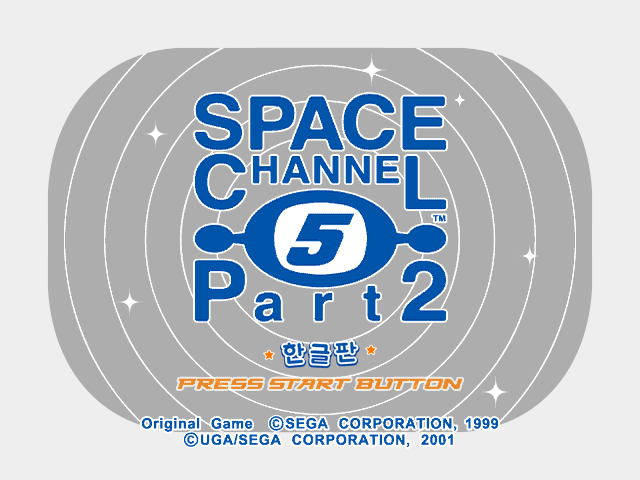 | 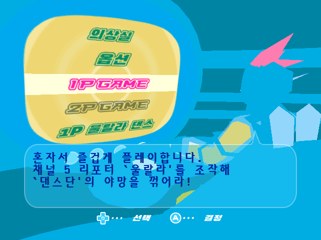 |

| 판정 설정 · 원작 판정인 1단계 | 판정 설정 · 가장 넓은 6단계 |
| :---: | :---: |
| 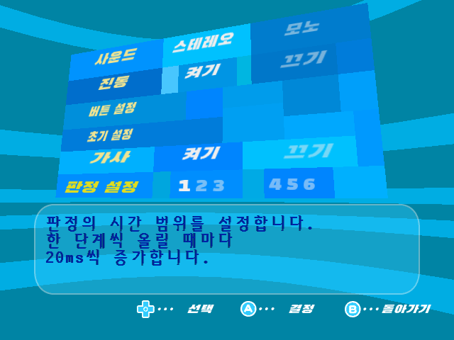 | 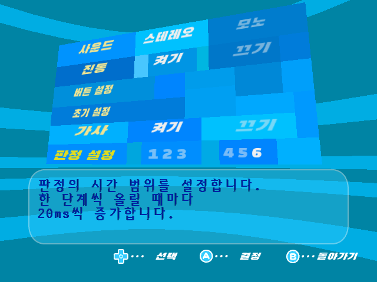 |

| 옵션 · 가사와 판정 설정의 선택 색상 | 리포트 선택 · 한국어 설명과 기록 |
| :---: | :---: |
| 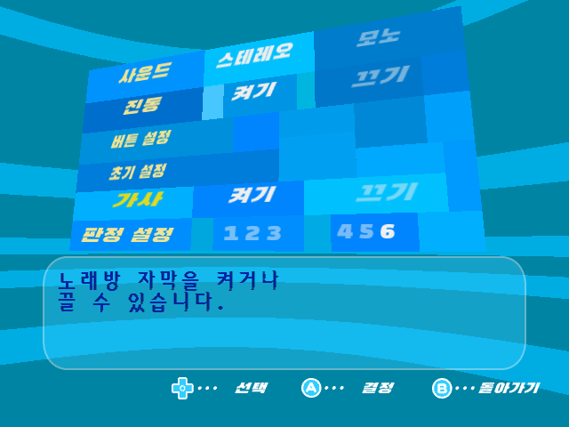 | 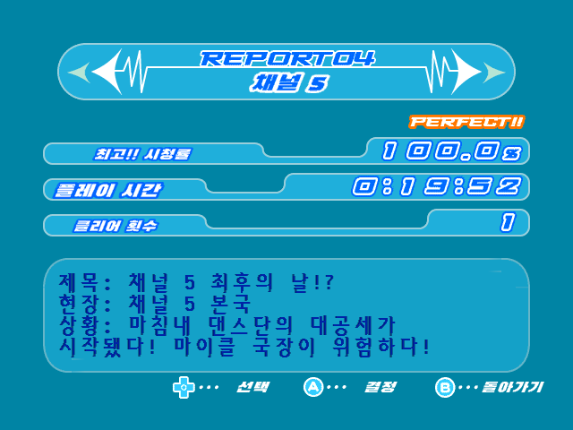 |

| 의상실 · 의상 이름과 설명 | 의상실 · 마이크 이름과 설명 |
| :---: | :---: |
| 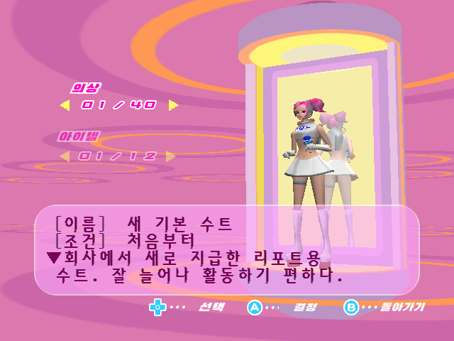 | 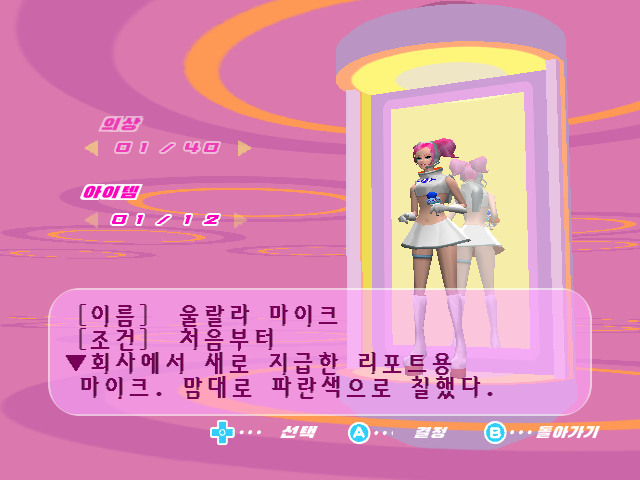 |

| 영상 · 위치 표기와 정렬 | 영상 · 제규어 소개 이름표와 대사 |
| :---: | :---: |
| 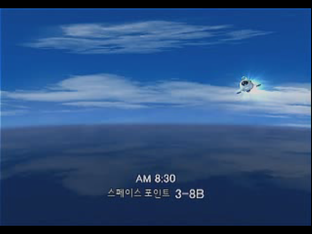 | 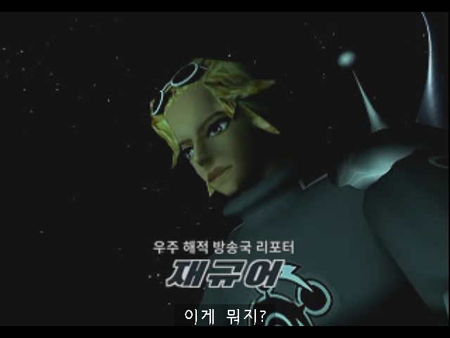 |

| 영상 · 푸딩 소개 이름표와 대사 | 리포트 2 · 영상 속 안내와 대사 자막 |
| :---: | :---: |
| 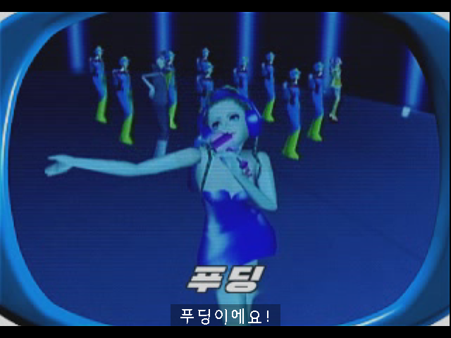 | 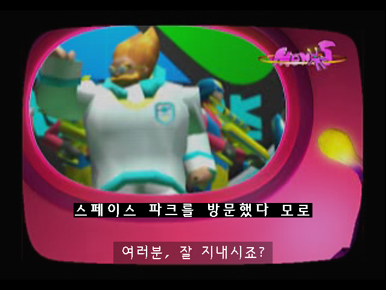 |

| 리포트 3 · 플레이 중 대사 자막 | 리포트 4 · 플레이 중 대사 자막 |
| :---: | :---: |
| 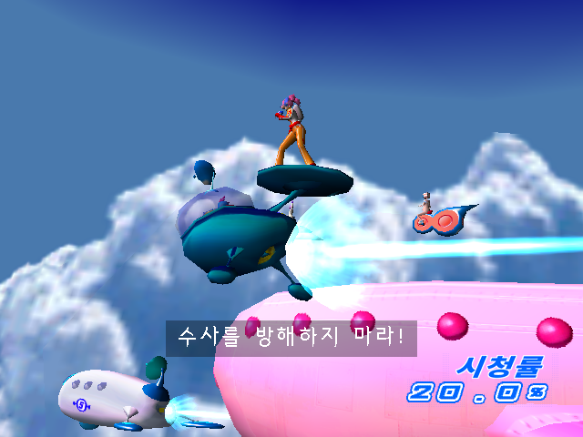 | 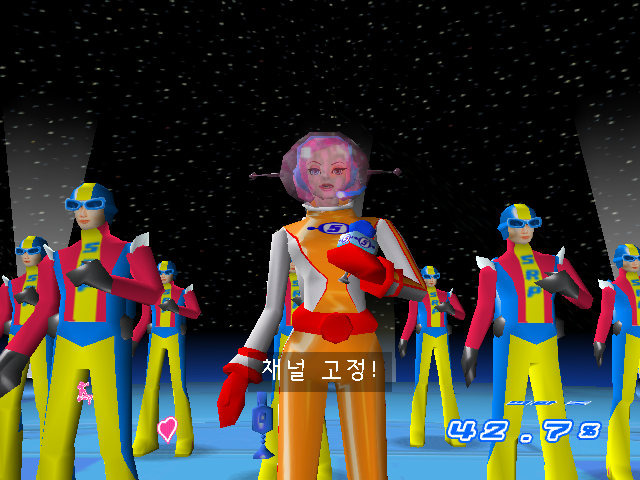 |

| 리포트 5 · 플레이 중 대사 자막 | 결과 화면 · 시청률, 구조율, 숨은 요소 발견 |
| :---: | :---: |
| 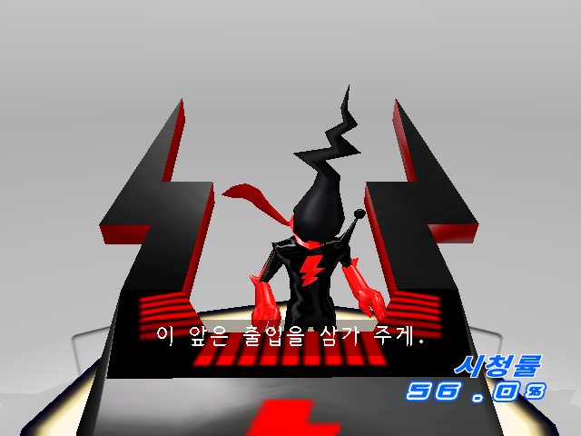 | 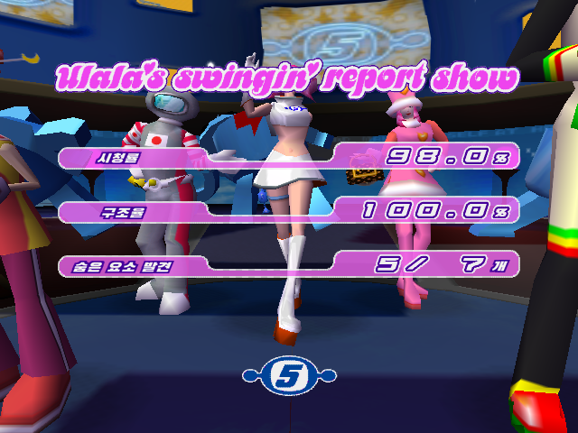 |

[처음으로](../README.md) · [변경 내역](../CHANGELOG.md)
